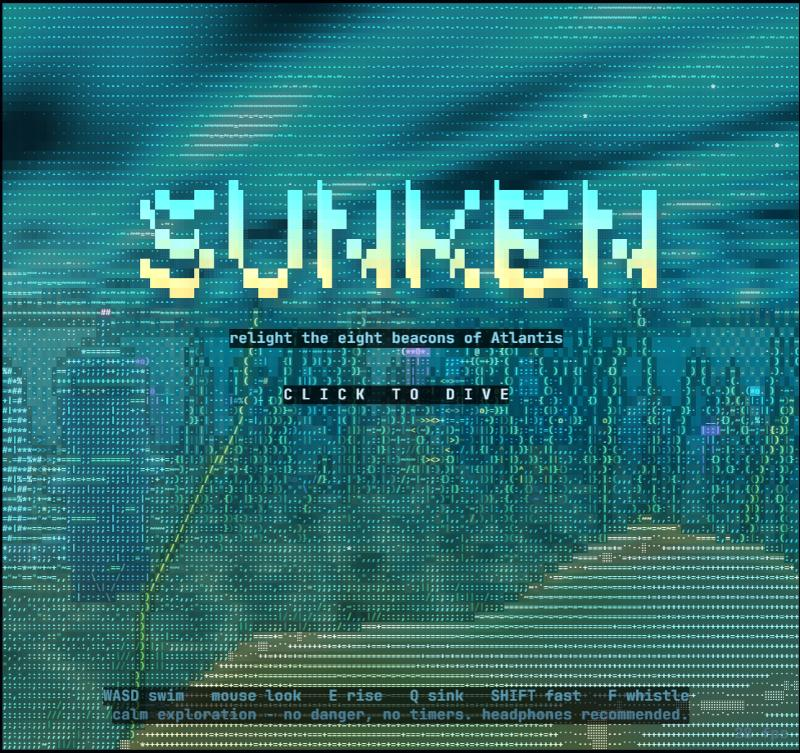

# SUNKEN

A calm 3D underwater exploration game, drawn entirely in text characters in your browser.

**▶ Play: https://adi-devv.github.io/sunken/**

Dive through kelp, reefs and a dark trench to find the eight relics that relight the beacons of sunken Atlantis. Whistle for dolphins and they'll guide you to the next one. Light all eight and the city wakes up with a light show, credits and a summary of your dive.

Along the way:

- **Air.** Your air runs down underwater. Surface, or hover in a bubble vent, to breathe.
- **The whale.** A huge whale roams the sea, sometimes swallows a school of fish, and now and then breaches clear out of the water. Swim onto its back and press G to ride it.
- **Treasure.** A pirate wreck in the kelp, a sea cave hiding a chest, and pirate gold buried on the island beach. Glowing golden fish lead you to pearls and lost pages of lore.
- **The world.** Day and night with glowing plankton after dark, rain and thunderstorms, and an island with trees and birds you can walk around.
- **Photos.** Press R to snap a photo. Each new creature you photograph goes in your journal.

Every frame is ray-marched on the CPU, one ray per character. It's a single HTML file with no dependencies.

## Controls

| Key | Action |
|---|---|
| WASD + mouse | swim and look |
| E / Q | rise / sink |
| Shift | swim fast |
| F | whistle for dolphins |
| R | take a photo |
| G | hold on to / let go of the whale (A / D steer it) |
| Space (on land) | jump |
| J / M / P | journal / mute / pause |

## Run locally

Open `sunken.html` in Chrome or Edge, or run `python -m http.server 8000` and go to http://localhost:8000/sunken.html.
